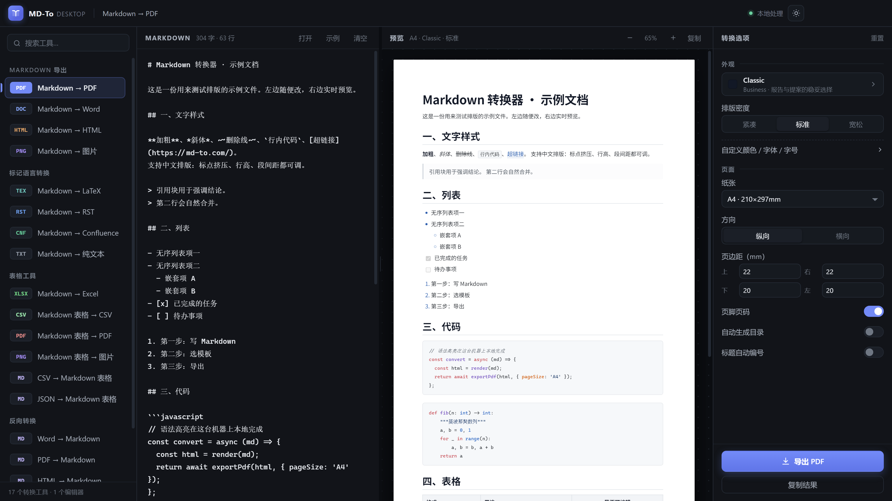

# MD-To Desktop

把 [md-to.com](https://md-to.com/) 的全部 Markdown 转换能力做成本地桌面程序。18 个工具、22 套文档模板，全部在本机完成，不联网、不上传。



## 包含的功能

**Markdown 导出**

| 工具 | 说明 |
| --- | --- |
| Markdown → PDF | 按模板排版，分页精确，代码块/表格/标题不会撕裂，可加页码与目录 |
| Markdown → Word | 原生 `.docx`，标题用 Word 内置样式，表格图片可继续编辑，可插入自动目录 |
| Markdown → HTML | 带完整样式的单文件 HTML，也可只导出正文片段 |
| Markdown → 图片 | 整篇渲染成长图，1x/2x/3x 可选，PNG/JPEG |

**标记语言转换**

Markdown → LaTeX（可编译，带导言区）、→ reStructuredText、→ Confluence Wiki Markup、→ 纯文本。

**表格工具**

Markdown 表格 → CSV / PDF / 图片；Markdown → Excel（每个表一个工作表）；CSV → Markdown 表格；JSON → Markdown 表格。

**反向转换**

Word → Markdown（mammoth 解析，标题/列表/表格/图片还原）、PDF → Markdown（按字号推断标题层级，按行宽判断段落）、HTML → Markdown（turndown + GFM）。

**Markdown 编辑器**

左右分屏实时预览，随时导出 PDF / Word / HTML / 图片。

## 运行

绿色版（免安装，推荐）：

```
dist/MD-To Desktop/MD-To Desktop.exe
```

开发模式：

```bash
npm install
npm start
```

重新打包绿色版：

```bash
node build-portable.js
```

## 模板与排版

22 套内置模板（Classic、Modern、Ocean Blue、GitHub、Dracula、Midnight…），可调：

- 排版密度：紧凑 / 标准 / 宽松
- 颜色：标题、正文、链接、引用、代码、表头、斑马纹、强调色
- 字体：标题 / 正文 / 代码三组独立
- 字号：H1/H2/H3/正文/代码
- 间距：行高、标题前距、段后距
- 页面：A4/Letter/A5/A3/Legal、横纵向、四边页边距、页码、自动目录、标题编号

## 快捷键

| 键 | 功能 |
| --- | --- |
| `Ctrl+O` | 打开文件 |
| `Ctrl+S` | 导出当前工具的结果 |
| `Ctrl+Shift+C` | 复制结果（文档类复制富文本） |
| `Ctrl+Enter` | 立即刷新预览 |

## 目录结构

```
main.js                 主进程：窗口、菜单、PDF/图片渲染、Excel/Word/PDF 解析
lib/docx-builder.js     基于 markdown-it token 流的 .docx 生成器（不依赖 DOM）
renderer/
  index.html            界面骨架
  boot.js               渲染进程入口
  styles.css            UI 样式
  js/theme.js           模板、配色、字体、文档 CSS
  js/markdown.js        渲染、目录、LaTeX/RST/Confluence/纯文本转换
  js/converters.js      CSV/JSON/HTML/PDF 转换与统计
  js/tools.js           18 个工具的定义与选项
  js/app.js             界面逻辑、预览、导出
test/smoke.js           自动化自检（18 项）
```

## 自检

```bash
node_modules/electron/dist/electron.exe test/smoke.js
```

会在 `test/out/` 生成一批真实产物（pdf/docx/xlsx/png/tex/rst/csv）并校验结构，结果写入 `test/results.json`。

## 已知限制

- PDF → Markdown 依赖 PDF 的文字层：扫描件、纯图片 PDF 无法提取。
- PDF 里的表格线不会还原成 Markdown 表格（只能按文本行输出）。
- Word → Markdown 不支持 `.doc`（旧二进制格式），仅 `.docx`。
- 文档内引用的网络图片需要联网才能嵌入 Word；其余功能全离线。

## 贡献者

| 贡献者 | 分工 |
| --- | --- |
| **DeepSeek** | 核心实现：Markdown 解析与渲染、LaTeX/RST/Confluence 转换器、PDF/Word/Excel 导出链路、PDF→Markdown 版面还原 |
| **WorkBuddy** | 工程与交付：Electron 应用骨架、界面设计与交互、22 套模板系统、自动化自检、绿色版打包 |
| Mark | 需求、验收与项目维护 |

## 许可

MIT License，详见 [LICENSE](LICENSE)。
